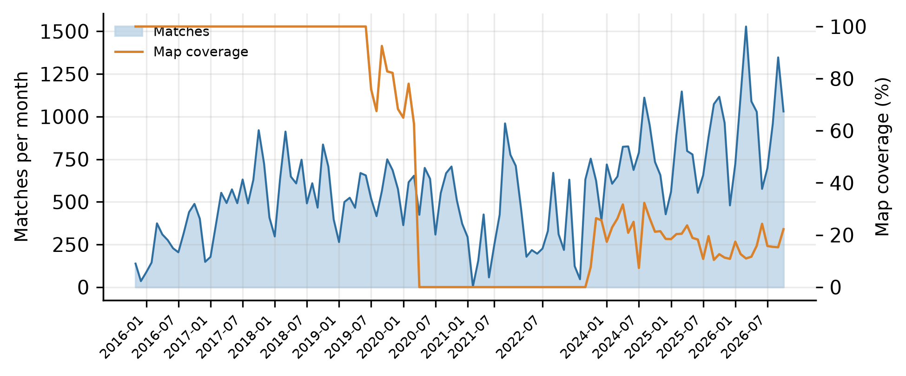
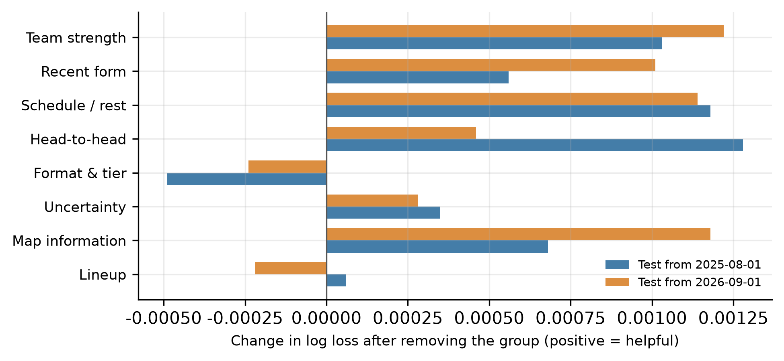
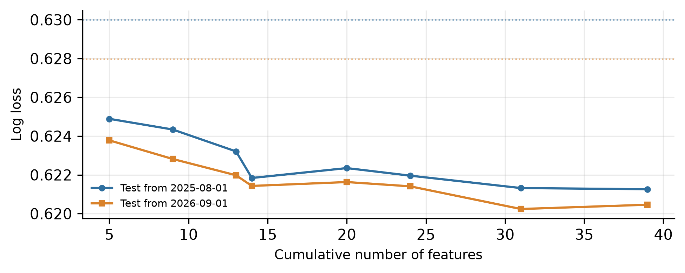
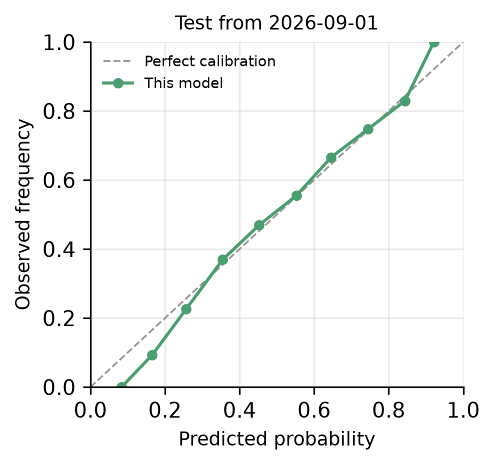
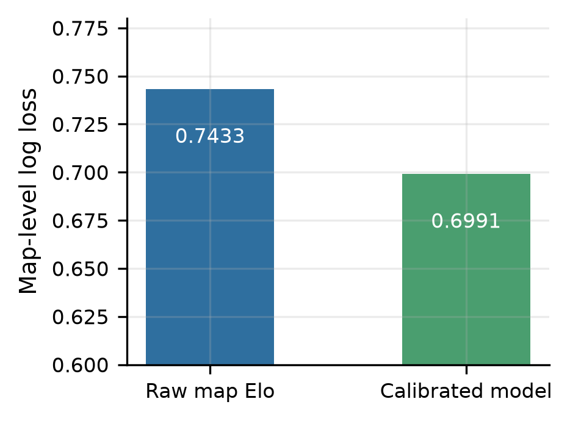
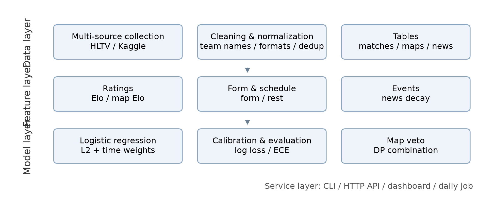
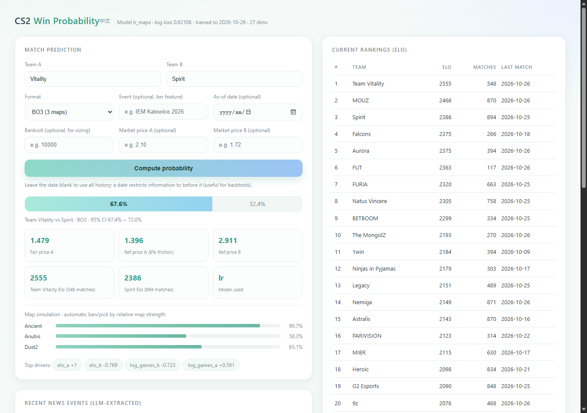

# Design and Implementation of a Win-Probability Prediction and Calibration System for CS2 Professional Matches

## Abstract

Professional Counter-Strike 2 (CS2) matches lack publicly available, well-calibrated win-probability tools. This paper presents an end-to-end system that predicts match outcomes from 68,523 professional matches played between 2015 and 2026. The system combines Elo ratings, recent form adjusted for opponent strength, head-to-head history, event tier and map-level information in a logistic regression model, and converts the resulting probabilities into fair prices, market-alignment assessments and position-sizing guidance. Under strict walk-forward evaluation, the model reduces log loss from 0.6290 (Elo baseline) to 0.6204, reaches 65.4% accuracy, and keeps expected calibration error below 1.9%. A feature-attribution study across three time splits shows that format and tier features are actively harmful out of sample: removing them improves log loss by 0.0014 on average. Two further hypotheses, namely modelling the number of maps explicitly and a "revenge" effect after a recent loss to the same opponent, are tested and rejected, with the negative results reported in full. The system also includes news-event extraction, a daily update pipeline, a command-line interface, an HTTP API and a bilingual dashboard.

Keywords: esports; win-probability prediction; Elo rating; logistic regression; calibration; reproducibility

## 1 Introduction

### 1.1 Background

Commercial interest in esports has grown substantially over the past decade, and with it the demand for quantitative forecasts of match outcomes. Compared with football or basketball, CS2 presents an unusual data landscape: match results are widely available, whereas detailed information such as map scores, roster changes and player form is scattered across sources that impose rate limits or access restrictions.

This landscape shapes the design of any prediction system. Three questions must be answered: how to obtain well-calibrated probabilities from limited features; how to guarantee that no future information leaks into training or evaluation; and how to translate probabilities into prices and decisions that a practitioner can act on.

### 1.2 Contributions

The contributions of this work are:

- A curated dataset of 68,523 professional matches (2015–2026) with 56,730 maps and 1,097 news articles, together with a cross-source deduplication and team-name normalization procedure.
- A feature set combining Elo ratings, opponent-adjusted form, head-to-head history, event tier and map-level Elo, evaluated with strict walk-forward splits.
- A map-level Elo model with veto simulation that converts per-map strengths into series probabilities, improving log loss by 0.0009 over a team-level baseline.
- A feature-attribution analysis that identifies format and tier features as harmful out of sample, and a 25-feature recommendation that improves log loss by 0.0014 on average across three splits.
- An implemented system: command-line tools, an HTTP API, a bilingual dashboard and a daily update job.
- Two pre-registered business hypotheses (explicit map-count modelling and an analyst/revenge effect) tested and rejected, with full negative results.

## 2 Related Work

### 2.1 Rating models

The Elo system (Elo, 1978) updates a rating from the difference between outcome and expected score and remains the standard baseline in both chess and team sports. Glickman's Glicko system adds a rating deviation to express uncertainty when samples are scarce. In team competitions, roster turnover and patch cycles motivate time decay, usually implemented as regression toward the mean or as exponential weighting of past matches.

### 2.2 Features and machine learning

Common features in sports forecasting include recent form, rest days, head-to-head records and event importance. Gradient boosting often outperforms linear models when features interact non-linearly, but with a few thousand effective samples and largely additive features, regularized logistic regression is frequently more robust. Probability calibration is typically handled by Platt scaling or isotonic regression.

### 2.3 Pricing and capital allocation

A price can be read as a market-implied probability once the margin is removed. The Kelly criterion (Kelly, 1956) gives the growth-optimal fraction of capital for a known edge; practitioners commonly use a fractional version to reduce variance. Predictive quality is assessed with strictly proper scoring rules such as log loss and the Brier score (Gneiting and Raftery, 2007).

## 3 Data

### 3.1 Sources

Three public sources were integrated, covering different periods and tiers (Table 3-1).

Table 3-1 Composition of data sources

<table><tr><th>Source</th><th>Records</th><th>Period</th><th>Notes</th></tr><tr><td>hojlund dataset</td><td>16,497</td><td>2015-11 – 2023-08</td><td>Maps and player stats</td></tr><tr><td>HLTV scrape</td><td>31,413</td><td>2023-08 – 2026-10</td><td>Event tier and stars</td></tr><tr><td>Kaggle dataset</td><td>21,599</td><td>2015-11 – 2020-03</td><td>Contains odds (unused)</td></tr></table>

Raw records total 69,509; after cross-source deduplication 68,523 matches remain, spanning November 2015 to October 2026 and involving 4,564 teams. The map table contains 56,730 maps, of which 14,449 fall after 2023.

Figure 3-1 shows monthly match volume and map coverage. Coverage is high in 2015–2020, drops sharply between 2021 and 2023, and recovers after 2023 as new sources are integrated.

Figure 3-1 Monthly match volume and map coverage

### 3.2 Cleaning

Cross-source merging is complicated by inconsistent team names: the same team may appear as "Falcons", "FALCONS" or "Team Falcons". A four-stage procedure (exact match, suffix-stripped match, prefix match, fuzzy match) was applied, merging 95 case variants.

Format fields are also mis-parsed by some sources: map scores are occasionally written into the series-score columns, turning BO1 matches into apparent BO5 matches. The number of maps actually present resolves the ambiguity; after correction the BO5 count falls from 11,175 to 684.

### 3.3 Leakage prevention

Every feature function satisfies the constraint that only pre-match information is used: ratings are replayed by match date, news events are filtered by publication time, and market prices never enter the feature set. Evaluation uses walk-forward splits in which the training set always precedes the test set, and hyperparameters are selected without touching the test period.

## 4 Method

### 4.1 Formalization

Given two teams and a match format, the task is to predict the probability $p$ that team A wins. The primary metric is log loss:

$$
L = -\frac{1}{N}(y_i \log p_i + (1-y_i)\log(1-p_i)) \tag{1}
$$

where $y_i \in \{0,1\}$ is the outcome. Calibration is measured by expected calibration error (ECE): predictions are binned, and the weighted average gap between predicted probability and observed frequency is computed.

### 4.2 Elo ratings

A team's rating $R_i$ is updated after each match:

$$
R_i' = R_i + K \cdot M \cdot (S - E) \tag{2}
$$

where $S$ is the outcome and $E$ the expected score:

$$
E = \frac{1}{1 + 10^{(R_j - R_i)/400}} \tag{3}
$$

$K$ is the update coefficient and $M$ a margin multiplier based on the map differential. To handle long absences, ratings decay toward the mean:

$$
R_i \leftarrow 1500 + (R_i - 1500)\cdot 2^{-\Delta t / T} \tag{4}
$$

with $\Delta t$ the days since the last match and $T$ the half-life; we use $K = 1.6K_0$, map-differential scaling for $M$, and $T = 180$ days.

### 4.3 Features

Twenty base features are constructed from the ratings, and two further groups are added (Table 4-1).

Table 4-1 Feature groups

<table><tr><th>Group</th><th>Features</th><th>Count</th></tr><tr><td>Ratings</td><td>Elo difference, both ratings, match counts</td><td>5</td></tr><tr><td>Form</td><td>Opponent-adjusted win rate over last 10 / 30 matches</td><td>4</td></tr><tr><td>Schedule</td><td>Rest days, match density</td><td>4</td></tr><tr><td>Head-to-head</td><td>Shrunk head-to-head record</td><td>1</td></tr><tr><td>Format and event</td><td>BO1/BO5, Major, top tier, LAN, year</td><td>6</td></tr><tr><td>Map</td><td>Map win rate, sample size, series probability</td><td>7</td></tr><tr><td>Lineup</td><td>Roster ADR, KAST and KD difference</td><td>8</td></tr></table>

Opponent-adjusted form is defined as the difference between actual and expected results, which removes the effect of schedule strength.

### 4.4 Logistic regression and calibration

The model is a logistic regression with L2 regularization:

$$
P(y=1\mid x) = \sigma(w^\top x + b), \quad \sigma(z)=\frac{1}{1+e^{-z}} \tag{5}
$$

Training samples are weighted by recency with a half-life of 1,500 days. A histogram gradient-boosting model is trained as a non-linear control.

### 4.5 Map-level Elo and veto simulation

Each team maintains an independent rating on each of the seven active maps, shrunk toward the team rating when fewer than five maps are observed. The per-map win probability is:

$$
p_m = \frac{1}{1 + 10^{(R_{B,m} - R_{A,m})/400}} \tag{6}
$$

The veto phase is simulated using relative map strength, defined as the difference between a team's map rating and its average map rating: weak maps are banned first and strong maps picked first, leaving one map for BO1, three for BO3 and five for BO5. The series probability is then obtained by dynamic programming:

$$
P_{\text{series}} = \Sigma_{W_A,\, W_B} \prod_{m \in W_A} p_m \prod_{m \in W_B} (1-p_m) \tag{7}
$$

where the sum runs over all map subsets consistent with the format and the $n$ required wins.

### 4.6 News event extraction

News text is converted into structured events by a large language model: transfers, injuries, coach changes and retirements. Each event carries a team, a direction, a magnitude and a confidence score, and is decayed into scalar features:

$$
s(t) = \Sigma_{k} v_k \cdot 2^{-(t - t_k)/\tau} \tag{8}
$$

where $v_k$ is the signed magnitude, $\tau$ the half-life (30 days), and only events from the 120 days preceding the match are counted. The language model is constrained to output events rather than probabilities; all probabilities are produced by the statistical model.

### 4.7 From probability to decision: market alignment and capital allocation

The model probability $p$ yields a fair price, and adding a market friction $m$ gives a reference quote. Given an observed market price $o$, the capital fraction (Kelly form) is:

$$
o = \frac{1}{p(1+m)}, \qquad f^{*} = \frac{po - 1}{o - 1} \tag{9}
$$

The applied fraction is $f = \min(\lambda f^{*}, f_{\max})$ with $\lambda = 0.25$ and $f_{\max} = 10\%$ of capital. When $po \le 1$ the position has no edge and no allocation is recommended.

## 5 Experiments

### 5.1 Protocol

Two time splits are used as the primary evaluation: training data up to 2025-08-01 and up to 2026-09-01, with all subsequent matches as the test set. A third split (2023-01-01) is added for robustness checks. All models are trained on the same feature matrix; hyperparameters are selected in a validation window that never overlaps the test period.

### 5.2 Main results

Table 5-1 Main results

<table><tr><th>Model</th><th>Features</th><th>2025-08</th><th>2026-09</th><th>Mean</th></tr><tr><td>Elo baseline</td><td>1</td><td>0.62999</td><td>0.62797</td><td>0.6290</td></tr><tr><td>Logistic regression</td><td>20</td><td>0.62235</td><td>0.62163</td><td>0.6220</td></tr><tr><td>LR + map features</td><td>27</td><td>0.62155</td><td>0.62057</td><td>0.6211</td></tr><tr><td>Recommended set</td><td>25</td><td>0.62076</td><td>0.62011</td><td>0.6204</td></tr><tr><td>Gradient boosting</td><td>27</td><td>0.62786</td><td>0.62766</td><td>0.6278</td></tr></table>

Test accuracy is 65.1% and 65.4% for the two splits, with expected calibration error 0.85% and 1.89%. Gradient boosting is consistently worse than the linear model, indicating that the available features are largely additive.

### 5.3 Ablation

Table 5-2 Ablation by feature group (change in log loss relative to the 20-feature baseline)

<table><tr><th>Feature group</th><th>2025-08</th><th>2026-09</th><th>Conclusion</th></tr><tr><td>Uncertainty, H2H count, interaction</td><td>-0.00039</td><td>-0.00022</td><td>Negligible</td></tr><tr><td>Average map win rate</td><td>-0.00019</td><td>-0.00040</td><td>Weak gain</td></tr><tr><td>Map-level Elo and veto</td><td>-0.00080</td><td>-0.00106</td><td>Effective</td></tr><tr><td>Lineup strength</td><td>-0.00003</td><td>+0.00025</td><td>No gain</td></tr><tr><td>LR + Elo ensemble</td><td>+0.00006</td><td>-0.00006</td><td>No gain</td></tr></table>

### 5.4 Discussion

Moving from the Elo baseline to the 20-feature model reduces log loss by about 0.007; map-level modelling adds roughly 0.001; all further attempts remain at the 0.0003 level. Three reasons explain this:

- Most new information correlates strongly with Elo. Map win rates and player statistics largely reflect team strength, and the residual after removing what Elo already explains is small.
- Player-level features enter as rolling averages and cannot express the sparse but decisive event of "who is on the server".
- The map-level model improves single-map prediction substantially (0.743 to 0.699) but this information is re-calibrated by the downstream logistic model, so the series-level gain is limited.

### 5.5 Attribution of information sources

To answer which kind of information actually helps, two complementary experiments were run: nested addition of feature groups and leave-one-group-out removal from the full model. Groups are listed in Table 5-3; results appear in Figures 5-1 and 5-2.

Table 5-3 Feature groups used in the attribution study

<table><tr><th>Group</th><th>Contents</th><th>Count</th></tr><tr><td>Team strength</td><td>Elo difference, ratings, match counts</td><td>5</td></tr><tr><td>Recent form</td><td>Opponent-adjusted win rate over 10 / 30 matches</td><td>4</td></tr><tr><td>Schedule</td><td>Rest days, match density</td><td>4</td></tr><tr><td>Head-to-head</td><td>Shrunk head-to-head record</td><td>1</td></tr><tr><td>Format and tier</td><td>BO1/BO5, Major, top tier, LAN, year</td><td>6</td></tr><tr><td>Uncertainty</td><td>Rating uncertainty, H2H count, interaction</td><td>4</td></tr><tr><td>Map information</td><td>Map win rate, sample size, series probability</td><td>7</td></tr><tr><td>Lineup</td><td>Roster ADR, KAST, KD difference</td><td>8</td></tr></table>

Figure 5-1 Leave-one-group-out contribution (positive means the group is helpful)

Figure 5-2 Log loss under nested feature addition (dotted lines: Elo baseline)

Both experiments agree on a counter-intuitive result: format and tier features contribute negatively. Removing the group from the full model reduces log loss by 0.00055 and 0.00024 on the two splits; adding it to a model that already contains head-to-head features raises log loss from 0.62184 to 0.62235. The reason is that year and event tier encode era drift: the model learns that "matches in a given year and tier upset more often", which does not transfer.

The recommended 25-feature set (team strength, form, schedule, head-to-head, uncertainty, map) is compared across three splits in Table 5-4.

Table 5-4 Recommended feature set versus baselines (log loss)

<table><tr><th>Feature set</th><th>Count</th><th>2023-01</th><th>2025-08</th><th>2026-09</th></tr><tr><td>Base</td><td>20</td><td>0.63026</td><td>0.62235</td><td>0.62163</td></tr><tr><td>Core (strength + H2H + map)</td><td>13</td><td>0.62988</td><td>0.62301</td><td>0.62245</td></tr><tr><td>Recommended</td><td>25</td><td>0.62933</td><td>0.62076</td><td>0.62011</td></tr><tr><td>Recommended + lineup</td><td>33</td><td>0.62933</td><td>0.62077</td><td>0.62022</td></tr></table>

The recommended set is better than the base set on all three splits, with an average gain of 0.0014; adding lineup features yields no further improvement, consistent with Section 5.3.

### 5.6 Calibration

Beyond discrimination, calibration determines whether the outputs are usable. Figure 5-3 shows the reliability curve of the recommended set on the 2026-09 split: binned observed frequencies lie close to the diagonal, and expected calibration error is 1.89%.

Figure 5-3 Reliability curve (test from 2026-09-01)

Figure 5-4 compares two ways of modelling a single map: raw map Elo gives log loss 0.74329, while re-calibrating with the map and team rating differences reduces it to 0.69911. The improvement is much larger than at series level, which confirms that map information is valuable in itself but is largely absorbed downstream.

Figure 5-4 Calibration of the single-map model

### 5.7 Two business hypotheses

Two assumptions often made in practice deserve falsification: first, that teams differ so much in map mastery that the number of maps (1/3/5) should be modelled explicitly; second, that a team which recently lost to an opponent studies the matchup and improves when they meet again. Both are tested below and rejected; the negative results are still informative for system design.

#### 5.7.1 Map count and map-pool depth

The current model already runs the veto simulation for the actual format. To test whether the format should be modelled explicitly, the series probability was additionally computed for BO1, BO3 and BO5 for every match (value and deviation from 0.5, six features) and offered to the model (Table 5-5).

Table 5-5 Log loss with explicit format modelling

<table><tr><th>Feature set</th><th>Count</th><th>2025-08</th><th>2026-09</th></tr><tr><td>Base + map</td><td>27</td><td>0.62166</td><td>0.62049</td></tr><tr><td>+ three-format probabilities</td><td>33</td><td>0.62153</td><td>0.62070</td></tr><tr><td>Three-format probabilities only</td><td>26</td><td>0.62190</td><td>0.62154</td></tr><tr><td>+ rematch features</td><td>31</td><td>0.62178</td><td>0.62072</td></tr></table>

One split improves and the other worsens, so the net gain is essentially zero. Subsets confirm this: on BO5 matches the map features get worse (0.62418 to 0.62717). The three format-specific probabilities are computed from the same rosters and the same map ratings, and are therefore highly correlated: the first map of a BO3 is usually the map that would be played in a BO1, so the new dimensions add redundancy rather than signal.

This does not reduce the value at the system level: the dashboard lets the user choose 1, 3 or 5 maps, re-runs the veto simulation for that format, and lists the per-map probabilities. For Vitality versus Spirit, BO1 gives 68.2% (Ancient 90.7%), BO3 gives 67.6% (Ancient 90.7%, Anubis 58.3%, Dust2 65.1%) and BO5 gives 69.8%: deeper map pools amplify the stronger team's advantage, which is exactly the information the model should convey, but it is already contained in the existing features.

#### 5.7.2 Rematches and the analyst effect

A rematch is defined as the second or later meeting of the same pair within 720 days. For 32,456 rematches, the repeat win rate of the previous winner is compared with its Elo expectation in Table 5-6.

Table 5-6 Repeat win rate of the previous winner in rematches

<table><tr><th>Sample</th><th>Matches</th><th>Observed</th><th>Elo expectation</th><th>Difference</th></tr><tr><td>All rematches</td><td>32,456</td><td>0.5823</td><td>0.5842</td><td>-0.0020</td></tr><tr><td>Gap 0–14 days</td><td>7,548</td><td>0.5951</td><td>0.5936</td><td>+0.0016</td></tr><tr><td>Gap 15–30 days</td><td>4,716</td><td>0.5908</td><td>0.6026</td><td>-0.0119</td></tr><tr><td>Gap 31–90 days</td><td>8,633</td><td>0.5822</td><td>0.5868</td><td>-0.0046</td></tr><tr><td>Gap 91–180 days</td><td>5,633</td><td>0.5731</td><td>0.5771</td><td>-0.0041</td></tr><tr><td>Previous winner was favourite</td><td>19,166</td><td>0.6773</td><td>0.7145</td><td>-0.0372</td></tr><tr><td>Previous winner was underdog</td><td>7,962</td><td>0.3937</td><td>0.3259</td><td>+0.0679</td></tr></table>

The overall difference is -0.0020 with a 95% confidence interval of [-0.0048, +0.0006], which crosses zero; by the criterion used throughout this paper, this is noise. Conditioning on the gap produces no stable direction either.

The subgroup split by favourite/underdog looks more supportive: when the previous winner was the favourite, the observed repeat rate is 3.7 points below expectation; when it was the underdog, 6.8 points above. But the same pattern appears in the full sample (underdogs outperform Elo by 6.4 points overall), so it reflects over-confidence of the raw Elo mapping rather than anything specific to rematches; after logistic calibration the expected calibration error is 1.89% and the bias is absorbed.

The corresponding rematch features (indicator, interaction with Elo difference, whether the team lost the previous meeting, gap in days) again produce one improvement and one deterioration (last row of Table 5-5) and were therefore not included in the final model.

The value of these negative results is that they rule out two plausible but ineffective modelling paths and turn two claims, namely that map-pool information is already covered by Elo plus veto simulation, and that Elo over-confidence must be fixed by calibration rather than by extra features, into reproducible evidence.

## 6 System

### 6.1 Architecture

The system has four layers: data, features, models and services. The data layer handles multi-source collection, deduplication and normalization; the feature layer replays matches to produce as-of feature matrices; the model layer trains, calibrates and persists models; the service layer exposes a command-line interface, an HTTP API and a bilingual dashboard (Figure 6-1).

Figure 6-1 System architecture

Figure 6-2 shows the dashboard, which contains match prediction, rankings, news events and a data overview.

Figure 6-2 The prediction dashboard

### 6.2 Command line and API

The command-line interface provides ingestion, backtesting, training, prediction, scraping and daily-update commands. The HTTP API exposes four read-only endpoints: prediction, rankings, dataset statistics and news. Requests and responses are JSON.

### 6.3 Dashboard

The dashboard is a single-page application. Users enter two teams, a format (1, 3 or 5 maps), an optional event and an optional as-of date; the system returns the win probability, a 95% interval, fair and reference prices, the simulated map pool with per-map probabilities, and the main drivers. When capital and market prices are supplied, the dashboard also reports a suggested position size, expected profit, median drawdown and ruin probability.

### 6.4 Daily update

The daily job fetches the latest results, checks how many matches were added, retrains when necessary and writes a dated report. It is scheduled through the operating system and, on ingestion failure, keeps the existing model and records the reason.

## 7 Limitations and future work

### 7.1 Data limitations

HLTV detail pages have long been protected against scraping, so map data after 2023 comes mainly from third-party datasets and covers about 17% of matches. News data spans only about five weeks and cannot support cross-period validation. Market prices were not available for a public evaluation.

### 7.2 Model limitations

The model assumes that team strength can be summarized by a low-dimensional rating; it cannot represent structural changes such as patch updates or map-pool rotation. The veto simulation is heuristic rather than learned from real ban/pick data, so map-pool counterplay is only approximated.

### 7.3 Future work

Three directions are promising: first, obtaining closing market prices to compute CLV and return metrics and test whether the model carries a real edge; second, accumulating news events over a longer horizon to evaluate roster-change information; third, replacing the point-estimate ratings with a Bayesian hierarchical model so that low-sample matches receive appropriately conservative predictions.

## 8 Conclusion

This paper presents an end-to-end system for predicting CS2 professional match outcomes and calibrating the resulting probabilities. Under strict time splits, log loss falls from 0.6290 to 0.6204, and the system delivers a complete chain from data to decision support. Feature attribution shows that format and tier features are harmful out of sample and that removing them improves all three splits. Two business hypotheses, explicit map-count modelling and an analyst effect after recent losses, were tested and rejected. For practical deployment, acquiring and evaluating market prices matters more than further model tuning.

## References

[1] ELO A E. The rating of chessplayers, past and present[M]. New York: Arco Publishing, 1978: 1-206. https://archive.org/details/ratingofchesspla0000eloa

[2] GLICKMAN M E. The Glicko system[EB/OL]. (1995-01-01)[2026-10-27]. http://www.glicko.net/glicko.html

[3] GNEITING T, RAFTERY A E. Strictly proper scoring rules, prediction, and estimation[J]. Journal of the American Statistical Association, 2007, 102(477): 359-378. https://doi.org/10.1198/016214506000001437

[4] KELLY J L. A new interpretation of information rate[J]. Bell System Technical Journal, 1956, 35(4): 917-926. https://doi.org/10.1002/j.1538-7305.1956.tb03809.x

[5] PLATT J. Probabilistic outputs for support vector machines and comparisons to regularized likelihood methods[C]//Advances in Large Margin Classifiers. Cambridge: MIT Press, 1999: 61-74. https://www.cs.colorado.edu/~mozer/Teaching/syllabi/6622/papers/Platt1999.pdf

[6] PEDREGOSA F, VAROQUAUX G, GRAMFORT A, et al. Scikit-learn: machine learning in Python[J]. Journal of Machine Learning Research, 2011, 12: 2825-2830. https://jmlr.org/papers/v12/pedregosa11a.html

[7] HASTIE T, TIBSHIRANI R, FRIEDMAN J. The elements of statistical learning[M]. 2nd ed. New York: Springer, 2009. https://doi.org/10.1007/978-0-387-84858-7

[8] HLTV. Counter-Strike news and matches[EB/OL]. [2026-10-27]. https://www.hltv.org

[9] Liquipedia. Counter-Strike[EB/OL]. [2026-10-27]. https://liquipedia.net/counterstrike

[10] Kaggle. Counter-Strike pro matches[EB/OL]. (2026-10-24)[2026-10-27]. https://www.kaggle.com/datasets/ektarr/counter-strike-pro-matches
