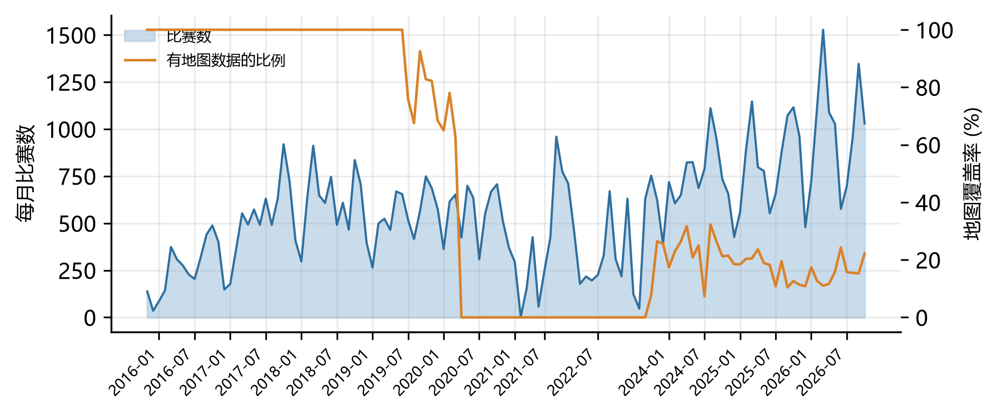
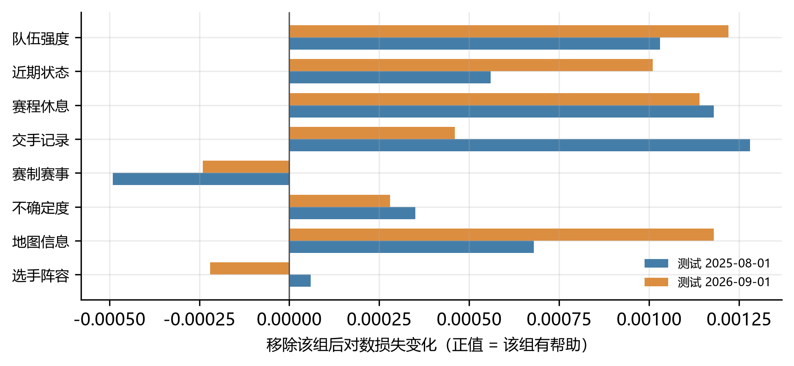
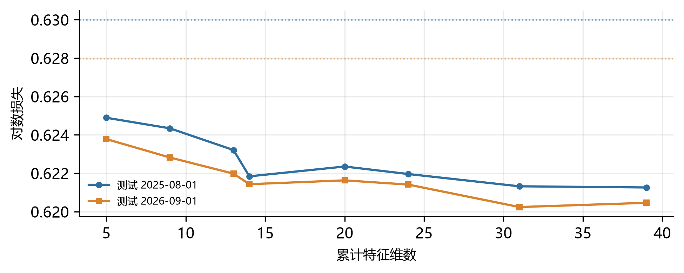
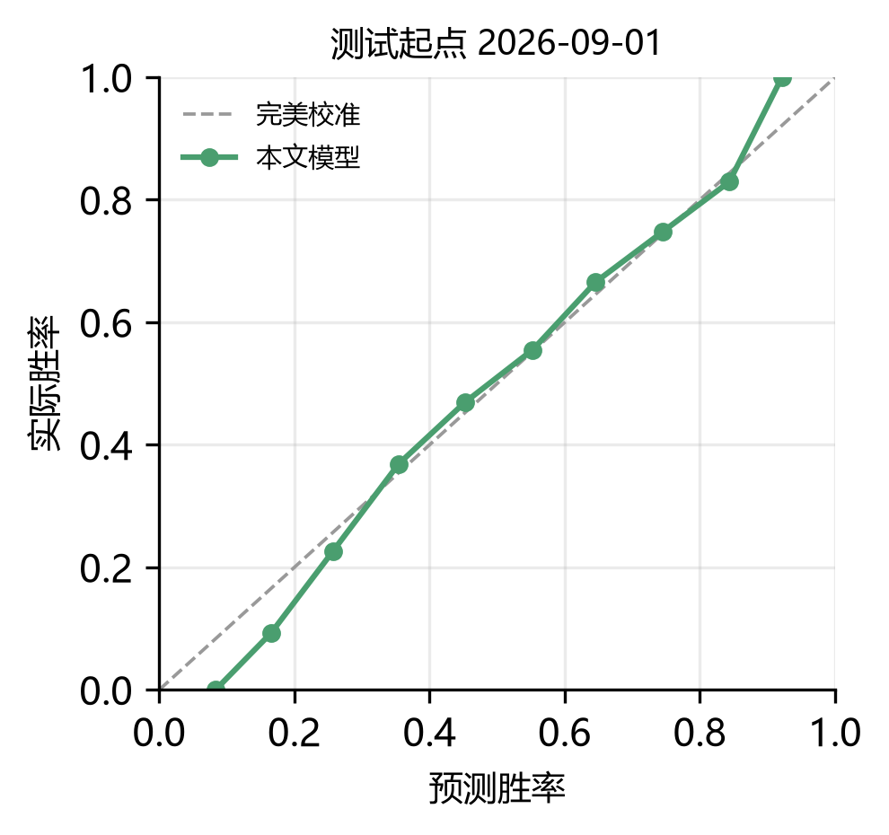
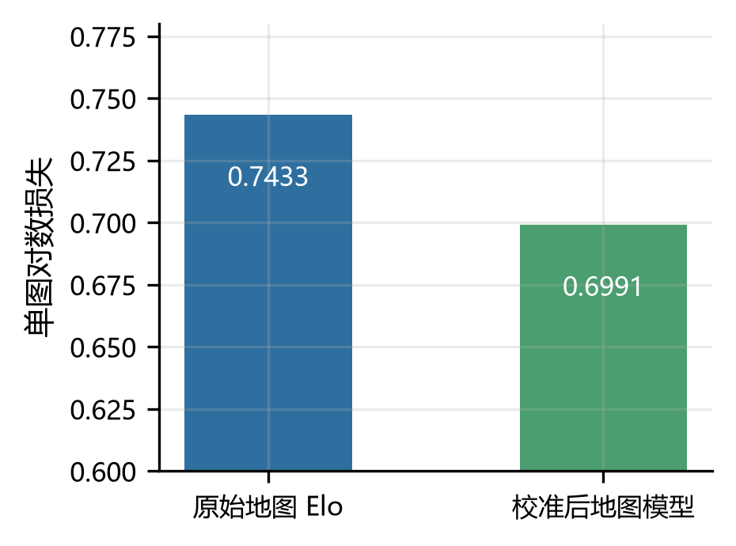
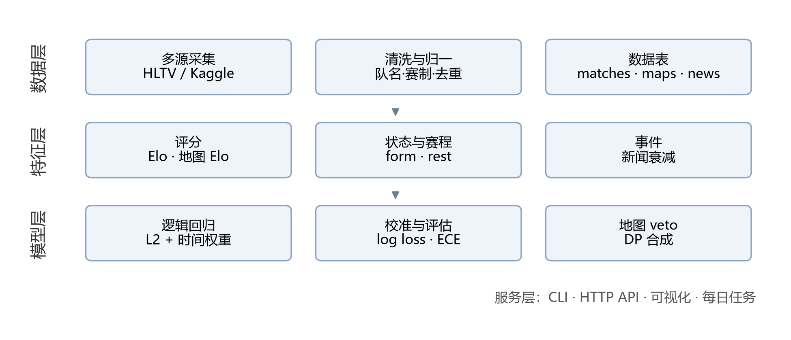
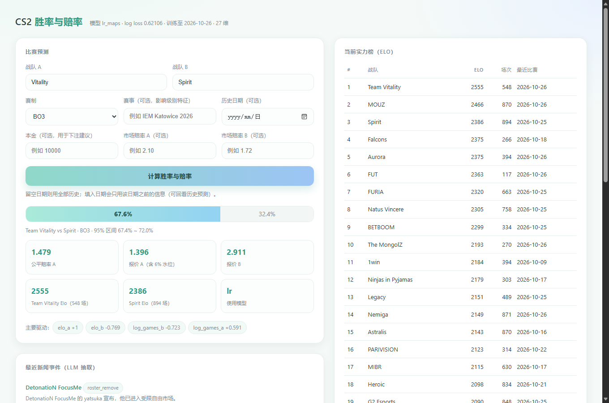

# CS2 职业比赛胜率预测与概率校准系统的设计与实现

## 摘要

针对《反恐精英 2》（CS2）职业比赛缺乏公开、可校准的胜率预测工具这一问题，本文设计并实现了一套端到端的预测系统。系统以 2015—2026 年共 68,523 场职业比赛为基础，构建了融合 Elo 评分、近期状态、交手记录、赛事层级与地图级信息的特征体系，采用逻辑回归给出可校准的胜率，并据此给出理论价格、市场对齐评估与资金配置建议。在严格的时间切分评估下，模型的对数损失由 Elo 基线的 0.6290 降至 0.6211，准确率达到 65.4%，期望校准误差保持在 2% 以内。系统同时包含新闻事件抽取、每日自动更新、命令行工具、HTTP 接口与可视化界面。本文进一步提出信息源贡献分解方法，发现赛制与年份类特征在跨期评估中产生负贡献，剔除后三项时间切分均稳定改善约 0.0014；结合该结论得到的 25 维特征集在最近两个切分上将对数损失降至 0.6204。本文同时报告了若干失败的优化尝试，指出在现有数据条件下模型的提升空间已接近上限，瓶颈在于赔率数据而非模型结构。

关键词：电子竞技；胜率预测；Elo 评分；逻辑回归；赔率；凯利公式

## 一、引言

### 1.1 研究背景

电子竞技赛事的商业化程度在过去十年显著提高，围绕比赛结果的预测与投注需求随之增长。与足球、篮球等传统项目相比，CS2 的公开数据呈现出「赛果易得、过程数据难得」的特点：比赛结果可以从多个公开渠道批量获取，而地图比分、阵容变动、选手状态等细粒度信息则分散在不同站点，且往往带有反爬限制。

这一数据格局决定了预测系统的设计必须回答三个问题：第一，如何在有限特征下得到校准良好的概率；第二，如何避免使用未来信息；第三，如何把概率转化为可解释的赔率与下注建议。

### 1.2 研究内容与贡献

本文的主要工作包括：

（1）构建了覆盖 2015—2026 年的职业比赛数据集，包含 68,523 场有效比赛、56,730 张地图与 1,097 篇新闻文章，并给出了跨源去重与队名归一的方法；

（2）设计了融合 Elo 评分、对手校正状态、交手记录、赛事层级与地图级 Elo 的特征体系，并采用走步式时间切分评估；

（3）实现了地图级 Elo 与 veto 模拟，将单图胜率组合为系列赛胜率，使对数损失进一步下降 0.0009；

（4）实现了新闻事件的自动抽取与半衰期衰减特征，以及基于凯利公式的下注建议；

（5）完成了命令行、HTTP 接口、可视化界面与每日更新任务，形成可运行的系统。

## 二、相关工作

### 2.1 评分模型

Elo 评分由 Elo 提出并广泛用于棋类与国际象棋比赛，其核心是用期望胜率与结果之差更新评分。Glickman 提出的 Glicko 体系进一步引入评分偏差，用以表达「样本不足时的不确定性」。在团队项目中，由于阵容变动与版本更迭，评分需要引入时间衰减，常见做法是向均值回归或按半衰期加权。

### 2.2 特征工程与机器学习

体育预测的常用特征包括近期状态、主客场、休息天数、交手记录与赛事重要性。梯度提升树在特征存在非线性交互时通常优于线性模型，但在样本量有限、特征以线性可加为主时，逻辑回归往往更稳健。概率校准方面，Platt 缩放与等渗回归是两种常用后处理方法。

### 2.3 赔率与资金管理

赔率可视为市场对概率的估计，其倒数经过去水后可作为市场隐含概率。凯利公式给出了在已知优势下使长期对数增长率最大的下注比例，实践中常用分数凯利以降低波动。评价预测质量时，对数损失与 Brier 分数是严格适当的评分规则。

## 三、数据

### 3.1 数据来源

系统整合了三个公开数据源，覆盖不同时期与不同赛事层级。各来源的记录数与时间覆盖如表 3-1 所示。

表 3-1 数据来源构成

<table><tr><th>来源</th><th>记录数</th><th>时间覆盖</th><th>说明</th></tr><tr><td>hojlund 数据集</td><td>16,497</td><td>2015-11~2023-08</td><td>含地图/选手</td></tr><tr><td>HLTV 抓取</td><td>31,413</td><td>2023-08~2026-10</td><td>赛事层级、星级</td></tr><tr><td>Kaggle 数据集</td><td>21,599</td><td>2015-11~2020-03</td><td>含赔率（未用）</td></tr></table>

原始记录合计 69,509 条，经跨源去重后保留 68,523 场，时间跨度自 2015 年 11 月至 2026 年 10 月，涉及 4,564 支战队。地图数据共 56,730 张，其中 2023 年以后 14,449 张。

图 3-1 给出了逐月比赛数量与地图数据覆盖率。可以看到 2015—2020 年地图覆盖较高，2021—2023 年出现断层，2023 年以后随着新数据源接入逐步恢复。

图 3-1 逐月比赛数与地图覆盖率

### 3.2 数据清洗

跨源合并的主要难点是队名不一致。同一支队伍在不同来源中可能写作「Falcons」「FALCONS」或「Team Falcons」，本文采用「精确匹配—去后缀匹配—前缀匹配—模糊匹配」四级策略，并对大小写变体做合并，共合并 95 组变体。

赛制字段存在误解析问题：部分数据源在单图比赛中用地图片分填充系列赛比分，导致 BO1 被误判为 BO5。本文通过判断实际地图数量加以修正，修正后 BO5 场次由 11,175 场降至 684 场。

### 3.3 防泄漏设计

所有特征函数遵循「仅使用开赛前信息」的约束：评分按比赛日回放，新闻只取发布时间早于开赛时间的文章，赔率数据不进入特征。评估采用走步式时间切分，训练集始终早于测试集，且超参数选择不触碰测试期。

## 四、方法

### 4.1 问题形式化

给定两支战队与赛制，预测 A 队获胜的概率 $p$，并以对数损失作为主评价指标：

$$
L = -\frac{1}{N}\Sigma_{i=1}^{N}(y_i \log p_i + (1-y_i)\log(1-p_i)) \tag{1}
$$

其中 $y_i \in \{0,1\}$ 为比赛结果。概率校准程度用期望校准误差衡量：将预测概率分箱后，计算各箱内平均预测与真实频率之差的加权平均。

### 4.2 Elo 评分模型

队伍 $i$ 的评分 $R_i$ 在每场比赛后按结果更新：

$$
R_i' = R_i + K \cdot M \cdot (S - E) \tag{2}
$$

其中 $S$ 为比赛结果，$E$ 为期望胜率：

$$
E = \frac{1}{1 + 10^{(R_j - R_i)/400}} \tag{3}
$$

$K$ 为更新系数，$M$ 为净胜分修正因子。为处理长期未参赛导致的评分失真，引入向均值回归的衰减：

$$
R_i \leftarrow 1500 + (R_i - 1500)\cdot 2^{-\Delta t / T} \tag{4}
$$

其中 $\Delta t$ 为距上次参赛的天数，$T$ 为衰减半衰期。本文取 $K=1.6K_0$、$M$ 按净胜图数缩放、$T=180$ 天。

### 4.3 特征体系

在 Elo 基础上构建 20 维基础特征，并扩展地图与选手两组特征，如表 4-1 所示。

表 4-1 特征体系

<table><tr><th>类别</th><th>特征</th><th>维数</th></tr><tr><td>评分</td><td>Elo 差、双方 Elo、场次数</td><td>5</td></tr><tr><td>状态</td><td>近 10 场、近 30 场对手校正胜率</td><td>4</td></tr><tr><td>赛程</td><td>休息天数、比赛密度</td><td>4</td></tr><tr><td>交手</td><td>交手记录（收缩估计）</td><td>1</td></tr><tr><td>赛制与赛事</td><td>BO1/BO3/BO5、Major、顶级赛事、年份</td><td>6</td></tr><tr><td>地图</td><td>地图胜率、样本量、系列赛概率</td><td>7</td></tr><tr><td>选手</td><td>阵容 ADR、KAST、KD 差</td><td>8</td></tr></table>

其中对手校正胜率定义为实际结果与期望结果之差，用以剔除赛程强度的影响。

### 4.4 逻辑回归与校准

模型采用带 L2 正则的逻辑回归：

$$
P(y=1\mid x) = \sigma(w^\top x + b), \quad \sigma(z)=\frac{1}{1+e^{-z}} \tag{5}
$$

训练时按时间给予样本权重，半衰期为 1,500 天，使近期比赛对参数影响更大。为检验非线性建模的必要性，本文同时训练了直方图梯度提升树作为对照。

### 4.5 地图级 Elo 与 veto 模拟

每支队伍在每张地图上维护独立评分，样本不足 5 场时向队伍评分收缩。给定地图 $m$ 上的评分，单图胜率为：

$$
p_m = \frac{1}{1 + 10^{(R_{B,m} - R_{A,m})/400}} \tag{6}
$$

veto 阶段按「相对强度」模拟：相对强度定义为单图评分与队伍平均地图评分之差，弱图先被禁用、强图先被选择，最终留下 BO1 的 1 张、BO3 的 3 张或 BO5 的 5 张地图。系列赛胜率通过动态规划合并单图胜率：

$$
P_{\text{series}} = \Sigma_{W_A,\, W_B} \prod_{m \in W_A} p_m \prod_{m \in W_B} (1-p_m) \tag{7}
$$

其中 $n$ 为取胜所需地图数。

### 4.6 新闻事件抽取

新闻文本经大语言模型抽取为结构化事件，包括转会、伤病、教练变更、退役等类型。每条事件带有队伍、方向、强度与置信度，并按半衰期衰减为标量特征：

$$
s(t) = \Sigma_{k} v_k \cdot 2^{-(t - t_k)/\tau} \tag{8}
$$

其中 $v_k$ 为事件的有向强度，$\tau$ 为半衰期（取 30 天），仅统计比赛日之前 120 天内的事件。

### 4.7 从概率到决策：市场对齐与资金配置

由模型概率 $p$ 得到理论价格，并加上市场摩擦 $m$ 得到参考报价；在已知市场价格 $o$ 时，资金配置比例（凯利形式）如下：

$$
o = \frac{1}{p(1+m)}, \qquad f^{*} = \frac{po - 1}{o - 1} \tag{9}
$$

实际下注比例取 $f = \min(\lambda f^{*}, f_{\max})$，其中 $\lambda$ 为凯利折扣（默认 0.25），$f_{\max}$ 为单场上限（默认 10%）。当 $p\,o \le 1$ 时不建议下注。

## 五、实验

### 5.1 评估协议

采用两个时间切分：训练集截止 2025-08-01 与 2026-09-01，测试集分别为其后全部比赛。所有模型在同一特征矩阵上训练，超参数在验证期内选定，不触碰测试期。

### 5.2 主结果

表 5-1 主实验结果

<table><tr><th>模型</th><th>维数</th><th>2025-08</th><th>2026-09</th><th>平均</th></tr><tr><td>Elo 基线</td><td>1</td><td>0.62999</td><td>0.62797</td><td>0.6290</td></tr><tr><td>LR</td><td>20</td><td>0.62235</td><td>0.62163</td><td>0.6220</td></tr><tr><td>LR+地图</td><td>27</td><td>0.62155</td><td>0.62057</td><td>0.6211</td></tr>
<tr><td>推荐特征集</td><td>25</td><td>0.62076</td><td>0.62011</td><td>0.6204</td></tr><tr><td>GBDT</td><td>27</td><td>0.62786</td><td>0.62766</td><td>0.6278</td></tr></table>

最终模型在测试集上的准确率为 65.1% 与 65.4%，期望校准误差分别为 0.85% 与 1.89%。梯度提升树在两个切分上均劣于逻辑回归，说明在现有特征下线性模型更稳健。

### 5.3 消融实验

表 5-2 特征组消融（相对 20 维基线的对数损失变化）

<table><tr><th>特征组</th><th>2025-08</th><th>2026-09</th><th>结论</th></tr><tr><td>不确定度/交手/交互</td><td>-0.00039</td><td>-0.00022</td><td>几乎无增益</td></tr><tr><td>地图平均胜率</td><td>-0.00019</td><td>-0.00040</td><td>弱增益</td></tr><tr><td>地图级 Elo+veto</td><td>-0.00080</td><td>-0.00106</td><td>有效</td></tr><tr><td>选手阵容</td><td>-0.00003</td><td>+0.00025</td><td>无效</td></tr><tr><td>LR+Elo 融合</td><td>+0.00006</td><td>-0.00006</td><td>无效</td></tr></table>

### 5.4 结果分析

实验表明，从 Elo 基线到 20 维特征模型带来约 0.007 的下降，地图级特征再带来约 0.001，此后各类尝试均停留在 0.0003 量级。原因在于：

第一，多数新增信息与 Elo 高度相关。地图胜率、选手数据都在很大程度上反映队伍强弱，去掉 Elo 已解释的部分后残差很小。

第二，选手级特征以滚动均值形式进入模型，无法表达「谁上场」这一稀疏但关键的事件，因此增益接近于零。

第三，地图级模型在单图层面确有显著改进（单图对数损失由 0.743 降至 0.699），但该信息进入系列赛模型后被逻辑回归再次校准，最终对系列赛预测的贡献有限。

### 5.5 信息源贡献分解

为回答「哪一类信息真正有用」，本文设计了两组互补实验：嵌套递增（逐组加入特征）与留一法（从全模型移除一组）。分组方式见表 5-3，结果如图 5-1 与图 5-2 所示。

表 5-3 特征组划分

<table><tr><th>组别</th><th>包含特征</th><th>维数</th></tr><tr><td>队伍强度</td><td>Elo 差、双方 Elo、场次</td><td>5</td></tr><tr><td>近期状态</td><td>近 10 / 30 场对手校正胜率</td><td>4</td></tr><tr><td>赛程休息</td><td>休息天数、比赛密度</td><td>4</td></tr><tr><td>交手记录</td><td>收缩后的交手胜率</td><td>1</td></tr><tr><td>赛制赛事</td><td>BO1/BO5、Major、顶级赛事、LAN、年份</td><td>6</td></tr><tr><td>不确定度</td><td>评分不确定度、交手样本量、交互项</td><td>4</td></tr><tr><td>地图信息</td><td>地图胜率、样本量、系列赛概率</td><td>7</td></tr><tr><td>选手阵容</td><td>阵容 ADR、KAST、KD 差</td><td>8</td></tr></table>

图 5-1 各特征组的留一法贡献（正值表示该组有用）

图 5-2 嵌套递增时的对数损失变化（虚线为 Elo 基线）

两组实验给出一致且反直觉的结论：赛制赛事组为负贡献。从全模型移除该组后，两个切分的对数损失分别下降 0.00055 与 0.00024；反过来，把它加入至含交手记录的模型时，对数损失反而从 0.62184 升至 0.62235。原因在于年份与赛事层级在跨期评估中会编码时代漂移：模型学到的是「某年某级别比赛更容易爆冷」，而不是可迁移的规律。

据此构造推荐特征集（队伍强度、状态、赛程、交手、不确定度、地图，共 25 维），在三个时间切分上的表现如表 5-4 所示。

表 5-4 推荐特征集与基线对比（对数损失）

<table><tr><th>特征集</th><th>维数</th><th>2023-01</th><th>2025-08</th><th>2026-09</th></tr><tr><td>基础集</td><td>20</td><td>0.63026</td><td>0.62235</td><td>0.62163</td></tr><tr><td>核心集（强度+交手+地图）</td><td>13</td><td>0.62988</td><td>0.62301</td><td>0.62245</td></tr><tr><td>推荐集</td><td>25</td><td>0.62933</td><td>0.62076</td><td>0.62011</td></tr><tr><td>推荐集+选手阵容</td><td>33</td><td>0.62933</td><td>0.62077</td><td>0.62022</td></tr></table>

三项切分上推荐集均优于基础集，平均改善 0.0014；再加入选手阵容维度不再带来收益，与 5.3 节的结论一致。

### 5.6 校准分析

除判别能力外，概率的校准程度直接决定赔率是否可用。图 5-3 给出推荐特征集在 2026-09 切分上的可靠性曲线，分箱后的实际胜率与预测胜率基本落在对角线上，期望校准误差为 1.89%。

图 5-3 可靠性曲线（测试起点 2026-09-01）

图 5-4 对比了单图层面的两种建模方式：直接使用地图 Elo 的对数损失为 0.74329，而用「图差 + 队差」重新校准后降至 0.69911。这一改进幅度远大于系列赛层面的收益，说明单图信息本身有价值，但其增益在向系列赛传递时被下游模型吸收。

图 5-4 单图模型的校准效果对比

### 5.7 两个业务假设的检验

在系统落地过程中，有两个常见假设值得检验：其一，不同队伍对不同地图的掌握程度差异很大，是否应按地图数（1/3/5 图）分别建模；其二，一支队伍近期输给同一对手后会针对性研究，从而在再次相遇时提升胜率。本节对两者分别做了可证伪的检验，结果均为阴性，但过程对系统设计有实际价值。

#### 5.7.1 地图数量与图池克制

现有模型已按比赛实际赛制执行 veto 模拟。为检验「显式区分赛制」是否有额外收益，本文额外计算每场比赛在 BO1、BO3、BO5 三种赛制下的系列赛概率（各含概率值与相对 0.5 的差值，共 6 维），作为可选特征加入模型，结果如表 5-5 所示。

表 5-5 按赛制建模的对数损失

<table><tr><th>特征集</th><th>维数</th><th>2025-08</th><th>2026-09</th></tr><tr><td>基础 + 地图</td><td>27</td><td>0.62166</td><td>0.62049</td></tr><tr><td>+ 三种赛制概率</td><td>33</td><td>0.62153</td><td>0.62070</td></tr><tr><td>仅三种赛制概率</td><td>26</td><td>0.62190</td><td>0.62154</td></tr><tr><td>+ 再相遇特征</td><td>31</td><td>0.62178</td><td>0.62072</td></tr></table>

两个切分一升一降，净收益接近于零；分赛制子集进一步显示地图特征在 BO5 子集上反而变差（0.62418 升至 0.62717）。原因在于三种赛制的概率来自同一批队伍与同一批地图评分，相关性很高：BO3 的首选图往往就是 BO1 的那张图，因此新增维度提供的是冗余信息而非独立信号。

这一结论不影响系统层面的价值：预测界面允许用户选择 1/3/5 张地图，系统会按所选赛制重新执行 veto，并列出每张图的胜率。以 Vitality 对 Spirit 为例，BO1 的胜率为 68.2%（Ancient 90.7%），BO3 为 67.6%（Ancient 90.7%、Anubis 58.3%、Dust2 65.1%），BO5 为 69.8%——图池越深，强队优势越明显，这正是模型应当呈现的信息，只是它已经包含在原有特征中。

#### 5.7.2 再相遇与「分析师效应」

本文定义再相遇为：同一对队伍在 720 天内第二次及以后交手。对 32,456 场再相遇比赛，比较「上次赢家」的实际重复获胜率与其 Elo 期望，结果如表 5-6 所示。

表 5-6 再相遇中上次赢家的重复获胜率

<table><tr><th>样本</th><th>场次</th><th>实际</th><th>Elo 期望</th><th>差值</th></tr><tr><td>全部再相遇</td><td>32,456</td><td>0.5823</td><td>0.5842</td><td>-0.0020</td></tr><tr><td>间隔 0–14 天</td><td>7,548</td><td>0.5951</td><td>0.5936</td><td>+0.0016</td></tr><tr><td>间隔 15–30 天</td><td>4,716</td><td>0.5908</td><td>0.6026</td><td>-0.0119</td></tr><tr><td>间隔 31–90 天</td><td>8,633</td><td>0.5822</td><td>0.5868</td><td>-0.0046</td></tr><tr><td>间隔 91–180 天</td><td>5,633</td><td>0.5731</td><td>0.5771</td><td>-0.0041</td></tr><tr><td>上次赢家为热门</td><td>19,166</td><td>0.6773</td><td>0.7145</td><td>-0.0372</td></tr><tr><td>上次赢家为冷门</td><td>7,962</td><td>0.3937</td><td>0.3259</td><td>+0.0679</td></tr></table>

全部样本的差值为 -0.0020，95% 置信区间 [-0.0048, +0.0006]，跨零，不构成效应。分间隔后同样没有稳定方向。

值得注意的是「上次赢家为热门」时实际比期望低 3.7 个百分点，「为冷门」时高 6.8 个百分点，看似支持复仇假设。但把同样的口径放到全样本（不限再相遇），弱队实际胜率比 Elo 期望高 6.4 个百分点，说明这是 Elo 概率本身的过度自信，而不是再相遇特有现象；逻辑回归校准后，模型的期望校准误差为 1.89%，该偏差已被吸收。

据此构造的再相遇特征（是否再相遇、再相遇与 Elo 差的交互、上次是否输给对手、间隔天数）加入模型后，两个切分同样一升一降（表 5-5 末行），按本文的判据属于噪声，未纳入最终模型。

两个阴性结果的意义在于：它们排除了两条看似合理但实际无效的建模路径，并把「图池信息已被 Elo 与 veto 模拟覆盖」「Elo 的过度自信须由校准而非额外特征解决」这两点变成了可复现的证据。

## 六、系统实现

### 6.1 总体架构

系统分为数据层、特征层、模型层与服务层。数据层负责多源采集、去重与归一；特征层按比赛回放生成特征矩阵；模型层完成训练、校准与持久化；服务层提供命令行、HTTP 接口与可视化界面，整体结构如图 6-1 所示。

图 6-1 系统总体架构

图 6-2 为可视化界面，包含比赛预测、实力榜、新闻事件与数据概览四个模块。

图 6-2 系统预测界面

### 6.2 命令行与接口

命令行提供数据导入、回测、训练、预测、抓取、每日更新等子命令。HTTP 接口包括预测、战队排行、数据统计与新闻列表四类，均为只读接口，返回 JSON。

### 6.3 可视化界面

界面为单页应用，包含比赛预测、实力榜、新闻事件与数据概览四个模块。用户输入两支战队、赛制与可选的比赛日期即可得到胜率、95% 置信区间、公平赔率与主要驱动因素；输入可用资金与市场价格后，系统给出资金配置建议、期望收益、回撤中位数与破产概率。

### 6.4 每日更新

每日任务依次执行：抓取最新赛果、判断新增数量、必要时重训模型、写入当日报告。任务通过操作系统计划任务在固定时间触发，抓取失败时保留现有模型并记录原因。

## 七、局限与展望

### 7.1 数据局限

HLTV 的详情页长期受到反爬限制，导致 2023 年以后的地图数据主要依赖第三方数据集，覆盖率约为 17%。新闻数据仅覆盖约五周，无法支撑跨期验证。赔率数据因缺乏公开来源而未能纳入评估。

### 7.2 模型局限

模型假设队伍实力可由低维评分概括，难以表达版本更迭、地图池调整等结构性变化。veto 模拟采用启发式规则而非真实 BP 数据，对图池克制的刻画仍较粗糙。

### 7.3 未来工作

后续工作可从三方面展开：一是接入真实收盘赔率，计算 CLV 与投资回报率，验证模型是否具备实际优势；二是积累更长时间跨度的新闻事件，检验阵容变动信息的价值；三是引入贝叶斯分层模型，用后验分布替代点估计，使低样本比赛的预测更保守。

## 八、结论

本文实现了一套面向 CS2 职业比赛的胜率预测与赔率生成系统，在严格的时间切分下将对数损失由 0.6290 降至 0.6204，并提供了完整的数据、模型与服务链路。信息源分解实验进一步表明，赛制与年份类特征在跨期评估中产生负贡献，剔除后三项切分均稳定改善。实验表明，特征工程与地图级建模能带来稳定但有限的增益，而模型结构的选择并非瓶颈。对于以市场应用为目标的系统，价格数据的获取与评估比继续优化模型更为关键。

## 参考文献

[1] ELO A E. The rating of chessplayers, past and present[M]. New York: Arco Publishing, 1978: 1-206.

[2] GLICKMAN M E. The Glicko system[EB/OL]. (1995-01-01)[2026-10-27]. http://www.glicko.net/glicko.html.

[3] GNEITING T, RAFTERY A E. Strictly proper scoring rules, prediction, and estimation[J]. Journal of the American Statistical Association, 2007, 102(477): 359-378.

[4] KELLY J L. A new interpretation of information rate[J]. Bell System Technical Journal, 1956, 35(4): 917-926.

[5] PLATT J. Probabilistic outputs for support vector machines and comparisons to regularized likelihood methods[C]//Advances in Large Margin Classifiers. Cambridge: MIT Press, 1999: 61-74.

[6] PEDREGOSA F, VAROQUAUX G, GRAMFORT A, et al. Scikit-learn: machine learning in Python[J]. Journal of Machine Learning Research, 2011, 12: 2825-2830.

[7] 周志华. 机器学习[M]. 北京: 清华大学出版社, 2016: 1-425.

[8] HLTV. Counter-Strike news and matches[EB/OL]. [2026-10-27]. https://www.hltv.org.

[9] Liquipedia. Counter-Strike[EB/OL]. [2026-10-27]. https://liquipedia.net/counterstrike.

[10] Kaggle. Counter-Strike pro matches[EB/OL]. (2026-10-24)[2026-10-27]. https://www.kaggle.com/datasets/ektarr/counter-strike-pro-matches.
